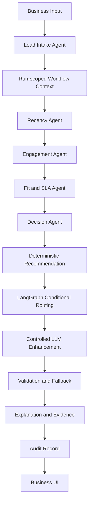
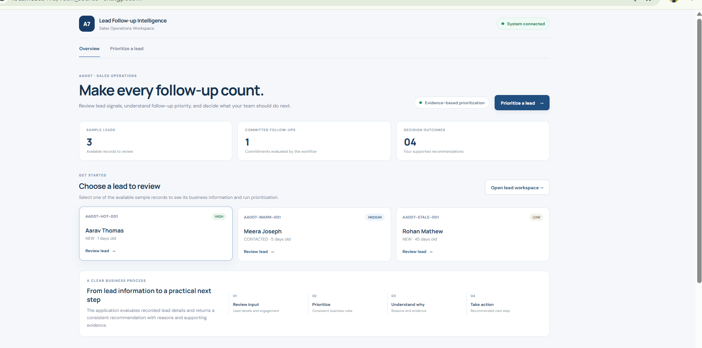
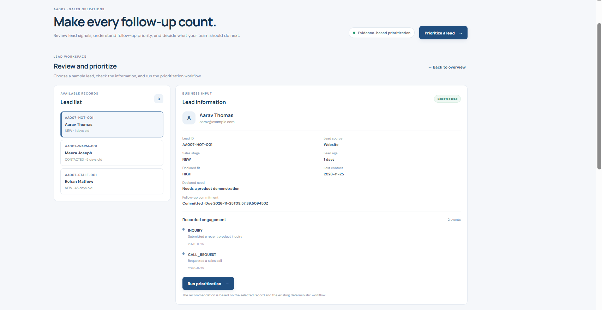
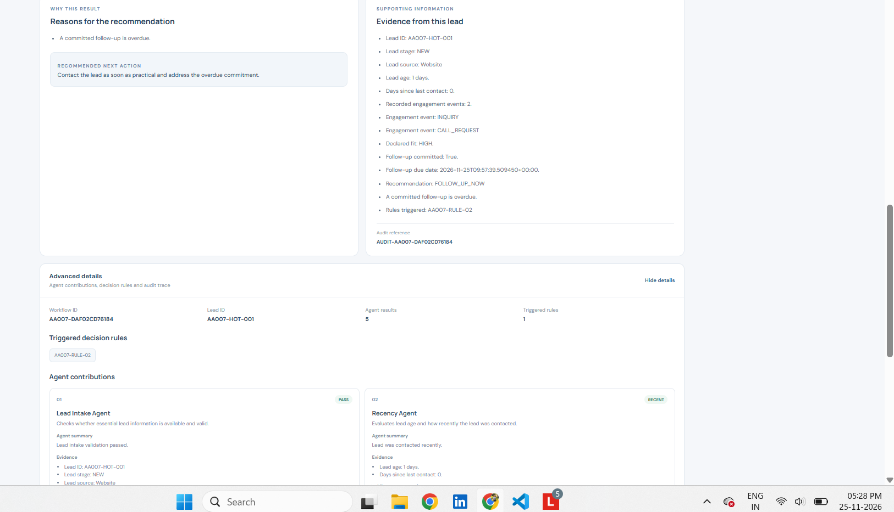
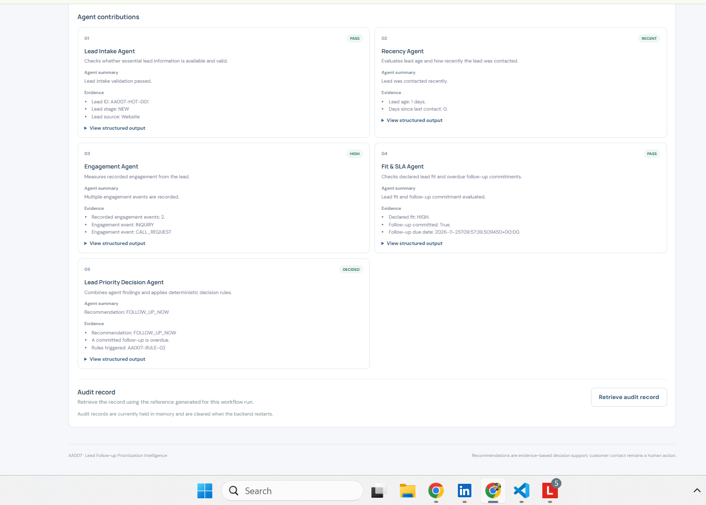

# AA007 — Lead Follow-up Prioritization Intelligence

**RealRails Agentic AI Internship — Batch 2 | Phase 3.2**

A business-focused, five-agent lead follow-up decision-support application using deterministic business rules, LangGraph orchestration and controlled LLM enhancement.

## Business Problem

Sales teams need a consistent way to prioritize lead follow-up using contact recency, engagement, declared fit and pending follow-up commitments instead of manual guesswork.

## Product Solution

AA007 evaluates structured lead information and provides:
- A recommended business action
- Reasons supporting the recommendation
- Evidence from the lead record
- Agent outputs and decision details
- An audit reference for workflow review

Primary users: sales coordinators, inside sales representatives and sales operations leads.

Customer contact remains a human decision.

## Architecture



The deterministic decision remains authoritative. The LLM does not calculate priority or control routing.

## Key Features

- Five specialized agents with separate business responsibilities.
- Structured input and output validation using Pydantic.
- Deterministic lead scoring and recommendation rules.
- LangGraph workflow orchestration and conditional routing.
- Controlled LLM enhancement for sales-note summarization and approved intent-tag extraction.
- Validated LLM output and deterministic fallback handling.
- Recommendation explanations, evidence and audit references.
- Business-facing interface with advanced technical details.

## Deterministic Recommendations

| Recommendation | Business condition |
|---|---|
| REQUEST_DATA | Mandatory lead information is incomplete |
| FOLLOW_UP_NOW | Committed follow-up is overdue or high-priority conditions apply |
| FOLLOW_UP_SOON | No higher-priority rule applies |
| NURTURE | Stale contact and low engagement |

## Technical Evolution

1. **Deterministic MVP:** Specialized agents and transparent business rules.
2. **LangGraph:** Existing agent responsibilities organized into graph-based orchestration.
3. **Conditional routing:** Workflow paths selected using deterministic business conditions.
4. **Controlled LLM:** An optional language enhancement with structured validation and fallback.

The LLM does not replace the deterministic decision authority.

## Demo Scenarios

See [Demo Scenarios](docs/phase32/DEMO_SCENARIOS.md).

1. Incomplete lead information — REQUEST_DATA.
2. High-fit, recently engaged lead — FOLLOW_UP_NOW.
3. Stale lead with low engagement — NURTURE.

A fourth verified outcome, FOLLOW_UP_SOON, is documented in the Phase 3.1 evidence.

## Technology Stack

| Layer | Technologies |
|---|---|
| Backend | Python, FastAPI |
| Agent orchestration | LangGraph |
| Data validation | Pydantic |
| LLM integration | Gemini and OpenAI provider integration |
| Frontend | React, Vite, TypeScript, CSS |
| Testing | Pytest |
| Development | Git, GitHub, Docker, Repomix |

## Run Locally

### Backend

```powershell
cd backend
pip install -r requirements.txt
uvicorn app.main:app --reload
```

Backend API: http://127.0.0.1:8000

API documentation: http://127.0.0.1:8000/docs

### Frontend

Open another terminal:

```powershell
cd frontend
npm install
npm run dev
```

Use the local frontend URL printed by Vite.

Configure optional provider credentials using `backend/.env.example`.
Keep actual credentials in `backend/.env`. Never commit secrets.

## Cloud Deployment

**Application URL:** https://aa007-lead-followup-intelligence.onrender.com

Do not treat the repository URL as the deployed application.

## Application Screenshots

### 1. Dashboard Overview
The main sales operations dashboard displaying available sample leads and system status.



### 2. Lead Workspace
Selected lead information, business details and recorded engagement.



### 3. Prioritization Result
Recommendation, business reasons and supporting evidence from the selected lead.



### 4. Agent Contributions and Audit
Five agent outputs, triggered decision rules and audit information.



Historical technical evidence is retained under `docs/phase2-evidence/`.

## Limitations and Non-Goals

- Uses seeded demonstration leads rather than verified live CRM integrations.
- Recommendations depend on configured business rules and available input data.
- LLM enhancement is bounded and may use deterministic fallback.
- The system does not autonomously contact customers.
- It does not provide automatic pricing, contracting or sales approval.
- It is an internship demonstration and is not claimed to be production-certified.

## Future Improvements

- Verified CRM integration.
- Persistent audit storage.
- Broader business-user evaluation.
- Additional deployment and operational monitoring.

## Validation Evidence

Phase 3.1 recorded four successful deterministic recommendation scenarios.

Evidence: `docs/phase3-evidence/four-outcome-verification.json`

Historical LLM and workflow evidence: `docs/phase2-evidence/`.

## Repository

https://github.com/dhanushacherian/AA007-Lead-Followup-Intelligence
